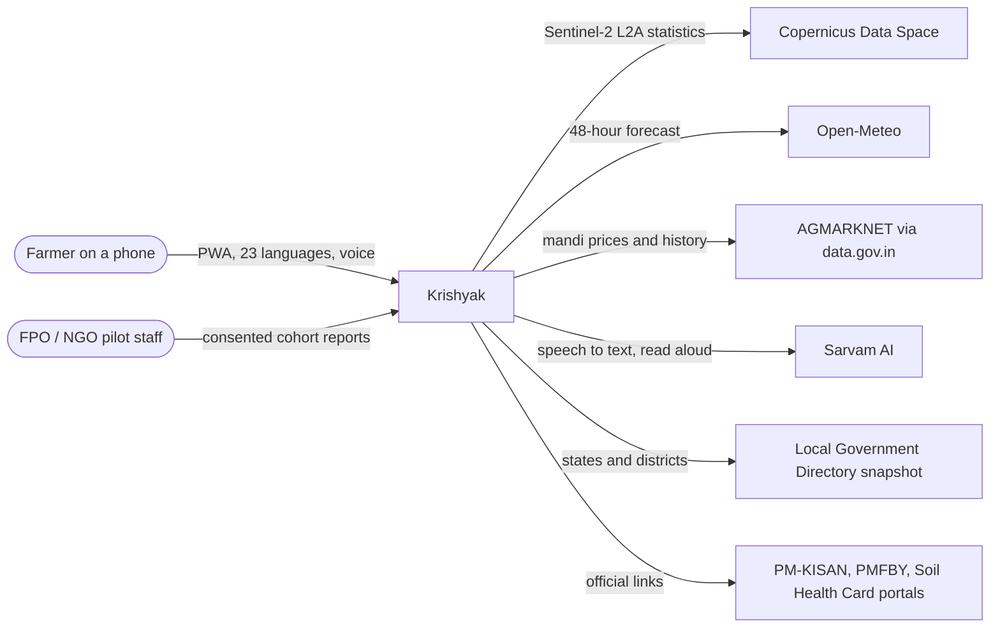
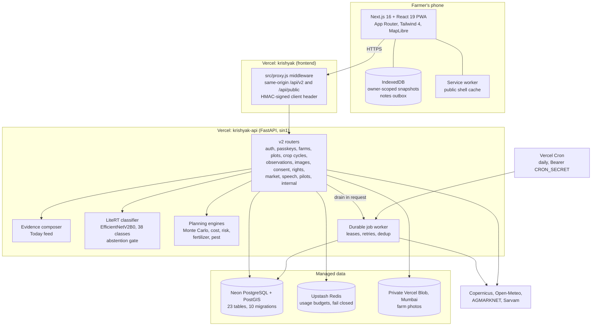
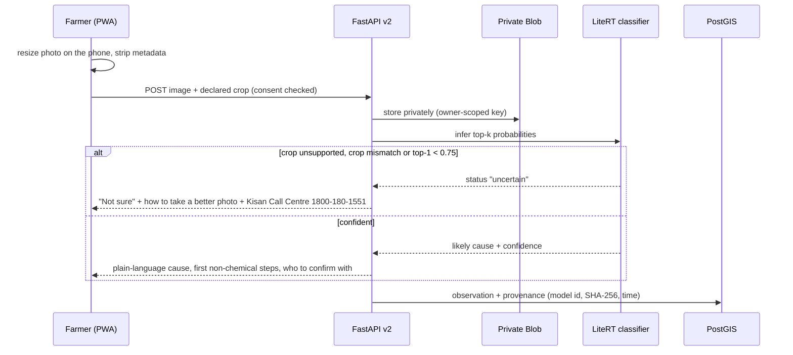
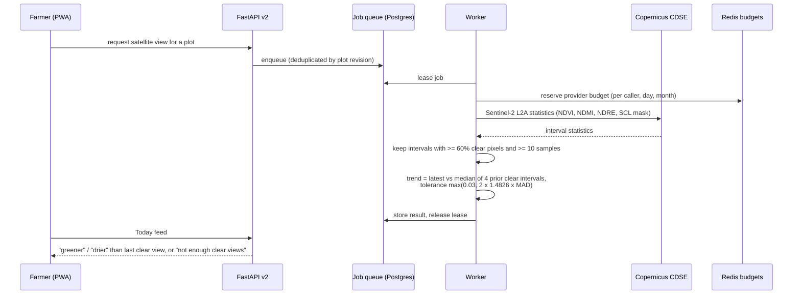
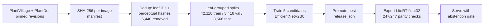
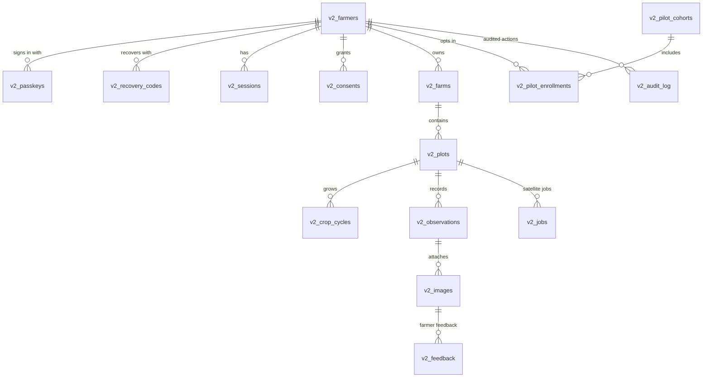

# Krishyak Technical Design Document

Krishyak is a field decision-support app for India's small and marginal
farmers. A farmer records a field once; Krishyak then turns a leaf photo, a GPS
point, Sentinel-2 satellite passes, the local forecast and mandi prices into
plain next steps in 22 scheduled Indian languages plus English.

| | |
|---|---|
| Live app | <https://krishyak.vercel.app> (farmer workspace at `/app/today`) |
| Demo farm (no sign-in) | <https://krishyak.vercel.app/demo> |
| API | FastAPI v2 on Vercel, region `sin1` |
| License | Apache-2.0 (see [LICENSE](../LICENSE) and [NOTICE](../NOTICE)) |
| Related docs | [API](v2/API.md), [database](v2/DATABASE.md), [security](v2/SECURITY.md), [deployment](v2/DEPLOYMENT.md), [offline](v2/OFFLINE_ARCHITECTURE.md), [remote sensing](v2/REMOTE_SENSING.md), [model governance](v2/MODEL_GOVERNANCE.md), [known limitations](v2/KNOWN_LIMITATIONS.md) |

## 1. Goals and design principles

1. **One record, many signals.** The farm, its plots and crop cycles are the
   spine; every photo, satellite reading, forecast and price attaches to it with
   a source and a date.
2. **Say "not sure" instead of guessing.** The disease model abstains on low
   confidence or a crop mismatch; satellite trends are shown only when clear
   pixels allow it; stale prices are labelled stale.
3. **Built for real phones and real networks.** Installable PWA, small static
   language packs, offline snapshots, no SMS dependency for sign-in.
4. **The farmer owns the data.** Purpose-wise consent, export, verified
   deletion, private photo storage in India, aggregates only above five farmers.
5. **Low running cost.** Serverless hosting, free open data (Sentinel-2,
   Open-Meteo), metered providers protected by usage budgets.

## 2. System context

## 3. Architecture

**Why a modular monolith.** One FastAPI deployable keeps latency and cost low on
serverless hosting while module boundaries (`backend/v2/*.py`,
`backend/remote_sensing/`) keep providers, auth and domain logic separate.
Jobs that call slow providers go through a Postgres-backed queue with leases,
drained inside requests and once a day by Vercel Cron; a dedicated worker
process (`python -m v2.worker`) is supported for container hosting.

## 4. Key flows

### 4.1 Leaf photo check

The model never gives pesticide product names or doses. Care steps live in
`backend/v2/disease_guidance.json` and are marked for agronomist review.

### 4.2 Satellite evidence for a field

Satellite indices never claim disease, nutrient status or yield. A
retrospective on 120 sites in 12 agro-regions (1,248 provider requests, zero
failures) shaped the clear-pixel and trend rules.

### 4.3 Season planning

The planning view compares the farmer's current plan, an optimised plan and a
worst case. Each run varies rainfall (plus or minus 20%), pest probability
(plus or minus 0.15), fertilizer (plus or minus 15%) and price (plus or minus
10%); 500 runs by default, 100 to 2,000 through the API, with a fixed seed for
reproducibility (`backend/simulation_engine.py`). Yield baselines come from
national 2024-25 crop statistics. Results are ranges and risk scores, not
promises.

## 5. Disease model pipeline

| Split | Images | Accuracy | Balanced accuracy | Macro F1 |
|---|---:|---:|---:|---:|
| Validation | 5,416 | 94.39% | 92.74% | 0.923 |
| Held-out test | 8,566 | 93.71% | 91.52% | 0.915 |

Selective prediction on the held-out test: the model answers 88.7% of photos
and is right 98.5% of the time when it answers. On harder field-style photos the
abstention gate cuts confident wrong answers from 42.8 to 5.2 per 100 photos.
Field validation on Indian farm photos is the next release gate (see
[model governance](v2/MODEL_GOVERNANCE.md)). Inference latency on a laptop CPU:
p50 124 ms, p95 220 ms.

## 6. Data model

Other tables: `v2_auth_challenges`, `v2_webauthn_challenges`,
`v2_government_identities`, `v2_object_deletions`, `v2_notifications`,
`v2_market_prices`, `v2_market_fetches`, `v2_worker_heartbeat`. Plots store
PostGIS geometry, computed hectares and a centroid; a GPS point rounded to
about 1 km is enough for weather. Locations use official LGD codes (36 states
and union territories, 784 districts, dated and hash-pinned snapshot). Schema
changes are Alembic migrations `v2_0001` to `v2_0010`, tested up, down and up
again in CI. Full detail: [database](v2/DATABASE.md).

## 7. Security and privacy

- **Sign-in:** WebAuthn passkeys (fingerprint or screen lock) with one-time
  recovery codes; no SMS or DLT dependency. Sessions are opaque, hashed,
  CSRF-protected and bound to the exact origin.
- **Edge:** the Next.js middleware forwards API calls same-origin and adds a
  two-minute HMAC-signed client header that the API trusts only with
  `KRISHYAK_PROXY_SECRET`.
- **Consent:** location, photo analysis, satellite and speech are asked in
  context with a reason and can be withdrawn in Settings.
- **Rights:** account export, and deletion that verifies photo erasure in
  storage (`backend/v2/rights.py`).
- **Providers:** credentials stay server-side; every provider is budgeted in
  Redis per caller, per day and per month, and budgets fail closed.
- **Supply chain:** Bandit, pip-audit and npm audit run in CI; model artifacts
  are SHA-256 pinned.

Detail: [security](v2/SECURITY.md), [threat model](v2/THREAT_MODEL.md),
[privacy](v2/PRIVACY.md).

## 8. Languages, voice and accessibility

- English plus all 22 scheduled languages ship as static, versioned JSON packs
  (`frontend/public/locales/workspace/*.json`, 1,980 strings each): no
  translation call at runtime, cached for offline use.
- Urdu, Kashmiri and Sindhi render right to left; Santali uses Ol Chiki and
  Manipuri uses Meitei Mayek with bundled Noto fonts.
- Voice input in 23 language codes (Sarvam `saaras:v3`); read-aloud in 11
  languages with a server voice (`bulbul:v3`), device voice otherwise.
- Browser tests run Axe accessibility checks.

## 9. Offline behaviour

The service worker caches only the public shell. Signed-in farmers can opt in
to owner-scoped IndexedDB snapshots (expire after 7 days) and a notes outbox
with idempotent IDs that syncs on reconnection and is cleared on sign-out.
Detail: [offline architecture](v2/OFFLINE_ARCHITECTURE.md).

## 10. Testing and CI

| Layer | Tooling | Scope |
|---|---|---|
| Backend | `unittest` (pytest compatible), real PostGIS and Redis in CI | 39 test modules: auth, passkeys, consent, rights, farms, images, evidence, satellite quality, market, speech, worker, migrations |
| Frontend | Jest 30 | 53 test files: components, i18n packs, offline queue, proxy |
| Browser | Playwright 1.63 + Axe | Chromium, Firefox, WebKit and a Pixel 7 profile: sign-up, photo check, satellite job, market, deletion, locales |
| Quality gates | Ruff, Prettier, ESLint, Bandit, pip-audit, npm audit, docs and locale validators | every pull request (`.github/workflows/v2-quality.yml`) |
| Live | `scripts/smoke_staging.py`, `e2e/staging.spec.js` | a deployed environment end to end |

How to run each suite and where the sample data lives:
[sample data and test cases](SAMPLE_DATA_AND_TESTS.md).

## 11. Key design decisions

| Decision | Choice | Why |
|---|---|---|
| Sign-in | Passkeys, not SMS OTP | SMS needs paid DLT registration; passkeys are free and phishing resistant |
| Model serving | LiteRT float32 in the API | 24.8 MB, no GPU, parity-checked against Keras |
| Uncertainty | Abstain below 0.75 or on crop mismatch | A wrong spray costs a season; "not sure" is safer than a confident error |
| Satellite trend | Median and MAD of prior clear intervals | Resistant to single cloudy or noisy readings |
| Languages | Static packs, no runtime translation | Works offline, reviewable, no per-request cost |
| Hosting | Serverless (Vercel, Neon, Upstash) | Near-zero idle cost for a pilot; region next to the database |
| Market trends | Same market, variety and grade only | Avoids invented trends from mixing series |

## 12. Roadmap

1. Jaipur district pilot with FPO partners: 40+ farmers, 500+ expert-labelled
   field photos.
2. Agronomist sign-off on guidance and native-speaker review of language packs,
   starting with Hindi.
3. Model v2 trained and benchmarked on Indian field photos; rice, wheat and
   cotton classes.
4. FPO dashboards on the same satellite pipeline; AgriStack adapters once
   partner access is approved.
